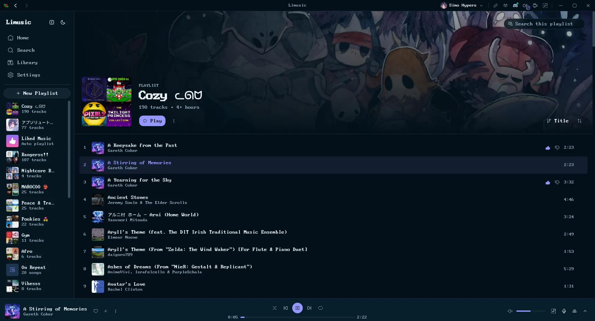
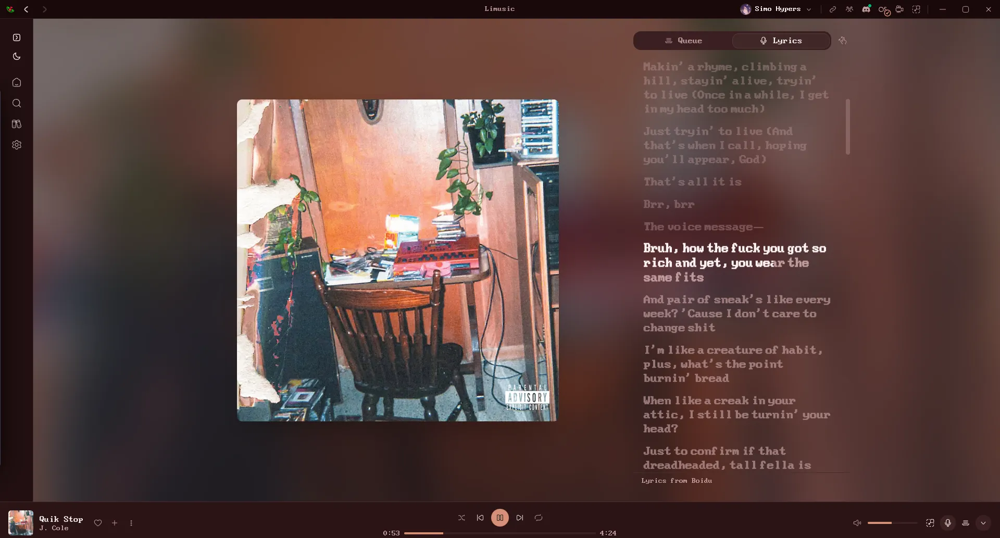
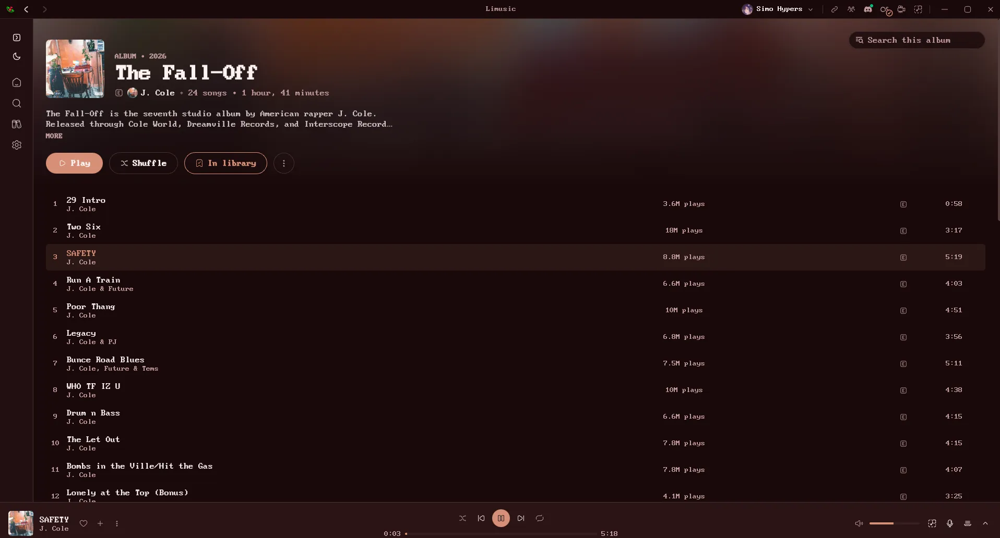
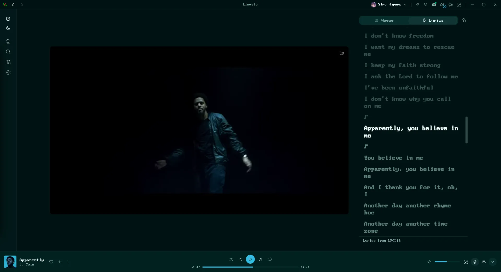

# Limusic Snap

Unofficial Snap package for [Limusic](https://github.com/SimoHypers/limusic), a
desktop YouTube Music client built with Tauri, Rust and SvelteKit.

[](https://github.com/NetNexusOrg/limusic-snap/releases/latest)
[](LICENSE)
[](#install)

<p align="center">
  
  
</p>
<p align="center">
  
  
</p>

> Limusic is developed by SimoHypers and licensed GPL-3.0. This Snap is not
> affiliated with or endorsed by the upstream author.

## Install

```bash
curl -LO https://github.com/NetNexusOrg/limusic-snap/releases/download/v1.4.1-6/limusic-community_1.4.1-6_amd64.snap
curl -LO https://github.com/NetNexusOrg/limusic-snap/releases/download/v1.4.1-6/limusic-community_1.4.1-6_amd64.snap.sha256
sha256sum -c limusic-community_1.4.1-6_amd64.snap.sha256
sudo snap install --dangerous ./limusic-community_1.4.1-6_amd64.snap
```

Ubuntu 24.04 or newer on `amd64`. The app appears in the desktop menu, or run
`limusic-community` in a terminal.

## Release channels

| Channel | Upstream source | Version | Status |
| --- | --- | --- | --- |
| `stable` | latest stable release | `1.4.1-6` | automatic, daily |
| `candidate` | latest release candidate | `<version>-<revision>` | automatic, daily |
| `beta` | `dev` branch | `git-dev-<sha>` | dormant |
| `edge` | `master` branch | `git-<sha>` | dormant |

Only `stable` and `candidate` are built automatically. The `beta` and `edge`
workflows exist but are not scheduled; they run only when triggered by hand.

The Snap Store name `limusic` belongs to another publisher, so this project uses
`limusic-community`. Nothing is published to the Snap Store: installations come
from GitHub Releases, one release per channel.

## What works

- YouTube Music streaming and Google login.
- Local music from your home directory.
- Audio playback through libmpv, with MPRIS media keys and a tray icon.
- Synced lyrics, artwork-based colors and music videos, including H.264/AAC.
- Last.fm scrobbling, with the API credentials built in.
- A single running instance, so links open in the window you already have.
- Updates through snapd, not the in-app updater.

## Known limitations

- **Discord Rich Presence** — snapd has no interface for the host Discord socket.
- **Start on login** — a strict Snap cannot write the host autostart file.
- **Karaoke** — CPU always works, GPU acceleration is best-effort.
- **wallust/pywal** — reads host dotfiles the `home` interface does not expose.

Full details, diagnostics and workarounds:
[docs/packaging.md](docs/packaging.md).

## Build

```bash
sudo snap install snapcraft --classic
sudo snap install lxd && lxd init --minimal
snapcraft pack --use-lxd
```

The result is `limusic-community_1.4.1-6_amd64.snap`. Build options, Last.fm credentials,
CI, interfaces and publishing are documented in
[docs/packaging.md](docs/packaging.md).

New upstream releases are detected daily and published automatically; see
[Automation](docs/packaging.md#automation).

## Links and credits

- Upstream: [SimoHypers/limusic](https://github.com/SimoHypers/limusic)
- Releases: [NetNexusOrg/limusic-snap](https://github.com/NetNexusOrg/limusic-snap/releases)
- Packaging issues: [NetNexusOrg/limusic-snap/issues](https://github.com/NetNexusOrg/limusic-snap/issues)
- Upstream bugs: [SimoHypers/limusic/issues](https://github.com/SimoHypers/limusic/issues)
- License: GPL-3.0, see [LICENSE](LICENSE). Limusic is by SimoHypers; this
  packaging is maintained by NetNexusOrg.
- Screenshots are from the upstream project.
